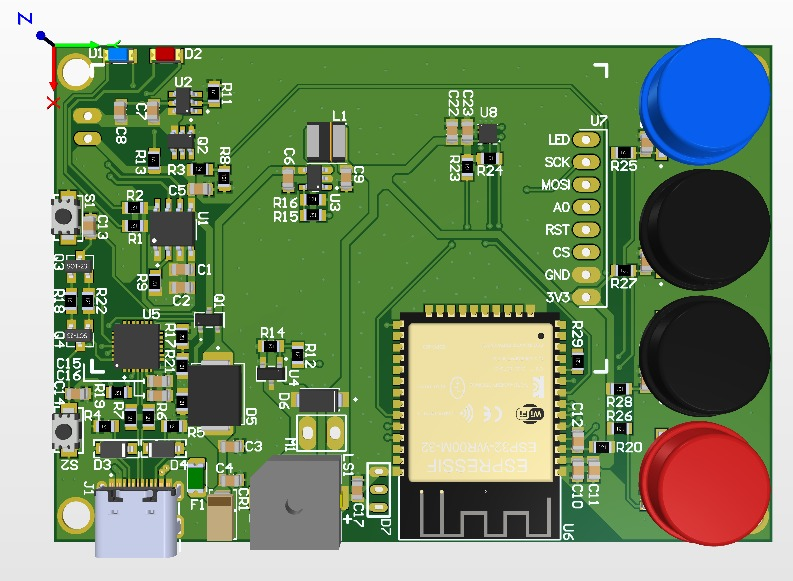
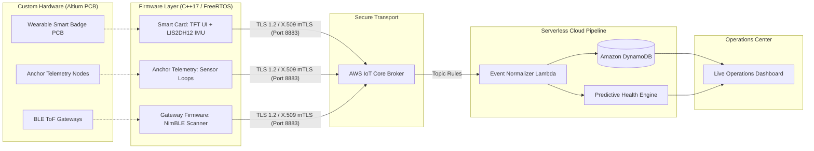

<div align="center">

# ⚡ Edge-to-Cloud Industrial IoT Operations Platform

**From Custom PCB Design to Enterprise Cloud: Hardware, Firmware, Serverless Telemetry & Predictive Analytics**

<br/>


<p><em>Custom Wearable PCB Hardware: ESP32-WROOM-32E + 1.8" SPI TFT + ST LIS2DH12 IMU + WS2812B + Li-Po Power Management</em></p>

<br/>

[](hardware/wearable-smart-badge/HARDWARE_DESIGN.md)
[](https://platformio.org/)
[](https://aws.amazon.com/)
[](https://isocpp.org/)
[](https://www.python.org/)
[](LICENSE)

[Hardware Design](hardware/wearable-smart-badge/HARDWARE_DESIGN.md) • [Architecture](docs/ARCHITECTURE.md) • [Protocol Spec](docs/PROTOCOL.md) • [ML Pipeline](docs/ML_PIPELINE.md) • [Dashboard](dashboard/) • [Firmware](firmware/)

</div>

---

## 📌 Executive Summary

This repository presents an authentic **Full-Stack, Hardware-to-Cloud Industrial IoT Operations Platform**. Unlike projects limited strictly to software or simulation, this platform spans the complete engineering lifecycle:
1. **Custom Hardware Engineering:** Designing multi-layer wearable and telemetry PCBs in **Altium Designer**, integrating power management, sensors, and display HMI.
2. **Production-Grade Firmware:** Developing non-blocking C++17/FreeRTOS embedded firmware with hardware mutual TLS (mTLS) and BLE micro-location scanning.
3. **Enterprise Serverless Cloud:** Ingesting high-throughput telemetry via AWS IoT Core, automated normalization through serverless Lambda, and DynamoDB storage.
4. **Predictive Analytics:** Anomaly detection and asset condition monitoring using tuned RandomForest classification on sliding-window time-series telemetry.
5. **Real-Time Operations Portal:** Responsive web dashboard for fleet supervisor task dispatching, sensor auditing, and live alerts.

---

## 🏛️ System Architecture: From Silicon to Cloud



---

## 💻 Full-Spectrum Engineering Tech Stack

| Layer | Technical Scope | Tools & Languages |
|---|---|---|
| **Hardware & PCB** | Multi-layer layout, controlled impedance, DFM/DFA, USB-C Li-Po power management, ST LIS2DH12 IMU, ST7735 SPI TFT | **Altium Designer, STEP 3D, Gerber** |
| **Edge Firmware** | Dual-core task segregation, FreeRTOS, non-blocking FSMs, NimBLE active beacon scanning, hardware mTLS | **C++ (C++17), PlatformIO** |
| **Cloud & Serverless** | AWS IoT Core rules engine, event normalization, multi-tenant partition key routing, DynamoDB TTL | **Python 3.10, AWS SDK (Boto3)** |
| **Predictive Analytics** | Time-series feature engineering (rolling RMS, temperature gradients), RandomForest classifier | **Python 3.10, Scikit-Learn, Pandas** |
| **Web Dashboard** | Real-time sensor charts, work order dispatcher, technician timeline, responsive SPA | **HTML5, JavaScript (ES6+), CSS3** |
| **DevOps & Tooling** | CI/CD pipelines, OTA flasher, end-to-end MQTT test simulator, UART JSON debugger | **GitHub Actions, Shell, Batch** |

---

## 📁 Repository Structure

```
edge-to-cloud-iot-operations/
├── hardware/                        # ══ Custom Hardware & PCB Engineering ══
│   └── wearable-smart-badge/        # Altium Designer layout, schematics & 3D renders
│       ├── images/smart_badge_3d_render.jpg
│       └── HARDWARE_DESIGN.md       # Pinout, schematic blocks, power budget & DFM
│
├── firmware/                        # ══ Embedded C++ Targets (PlatformIO) ══
│   ├── smart-card/                  # Wearable Smart Badge firmware (matched to custom PCB)
│   ├── anchor-unit/                 # Fixed field telemetry node (mTLS, FreeRTOS)
│   ├── ble-tof-gateway/             # BLE Time-of-Flight sensor aggregator
│   └── provisioning/                # Zero-touch factory bootstrap & OTA flasher
│
├── cloud/                           # ══ Serverless Cloud Pipeline ══
│   ├── lambda/                      # Telemetry normalization, event dedup & dispatch
│   ├── iot-rules/                   # AWS IoT Core SQL query definitions
│   └── infrastructure/              # DynamoDB single-table schema specifications
│
├── ml/                              # ══ Predictive Maintenance & Analytics ══
│   ├── train_model.py               # RandomForest classifier with rolling feature extraction
│   ├── predict_health.py            # Real-time condition scoring module
│   ├── reports/                     # Model metrics, feature importances & training logs
│   └── data/                        # Sample time-series sensor telemetry
│
├── dashboard/                       # ══ Operations Web Portal ══
│   ├── dashboard.html               # Live fleet overview & KPI cards
│   ├── assets.html                  # Machine & asset drill-down view
│   ├── sensors.html                 # Real-time multi-sensor telemetry stream
│   └── timeline.html                # Field technician audit timeline
│
├── tools/                           # ══ Engineering Utilities ══
│   ├── mqtt_simulator.py            # High-throughput synthetic telemetry generator
│   ├── serial_debugger.py           # Hardware UART stream inspector & JSON validator
│   └── collect_analytics.py         # DynamoDB telemetry exporter
│
├── scripts/                         # ══ Automation & Deployment Scripts ══
│   ├── setup_env.sh                 # Developer environment bootstrap
│   ├── flash_firmware.sh            # ESP32 OTA flashing script
│   └── deploy_ota.bat               # Windows CI/CD S3 deployer
│
└── docs/                            # ══ Technical Documentation ══
    ├── ARCHITECTURE.md              # Detailed topology and state machine flow
    ├── PROTOCOL.md                  # MQTT topic taxonomy and payload schemas
    └── ML_PIPELINE.md               # Feature engineering formulas and model weights
```

---

## 🚀 Key Engineering Achievements

### 1. Unified Hardware & Firmware Co-Design
* The firmware under [`firmware/smart-card/`](firmware/smart-card/) was engineered specifically for the custom PCB documented in [`hardware/wearable-smart-badge/`](hardware/wearable-smart-badge/).
* Direct pin mapping for the **ST7735 1.8" SPI TFT**, **ST LIS2DH12 3-axis IMU**, tactile input buttons, and addressable **WS2812B LEDs**.
* Power-conscious firmware design: leverages ESP32 light-sleep and deep-sleep states with motion wake-up interrupts from the LIS2DH12.

### 2. Enterprise-Grade Cloud Security
* Hardware-enforced mutual TLS (mTLS) with per-device private keys and X.509 certificates.
* Zero plaintext credentials: field devices authenticate directly to AWS IoT Core over port 8883.

### 3. Serverless Event Processing & Predictive ML
* Sub-100ms normalization latency with AWS Lambda.
* Condition-based asset health monitoring using statistical rolling metrics and machine learning classification.

---

## 🛠️ Quick Start

### 1. Set Up Environment
```bash
bash scripts/setup_env.sh
```

### 2. Simulate Field Telemetry
```bash
python tools/mqtt_simulator.py --devices 5 --interval 2.0
```

### 3. Train ML Health Model
```bash
python ml/train_model.py --data ml/data/sample_telemetry.csv
```

### 4. Build Firmware for Custom Badge PCB
```bash
cd firmware/smart-card
pio run
```

---

## 📄 License & Attribution

This project is licensed under the **Proprietary Source-Available Showcase License** - see the [LICENSE](LICENSE) file for full legal details.  
*Evaluation, code audit, and engineering review are permitted; unauthorized commercial deployment, PCB fabrication, and reproduction are strictly prohibited.*

Developed and architected by **[Kadir Mercan](https://www.linkedin.com/in/kadir-mercan-/)**  
*Senior Embedded Systems, Hardware & IoT Engineer*
