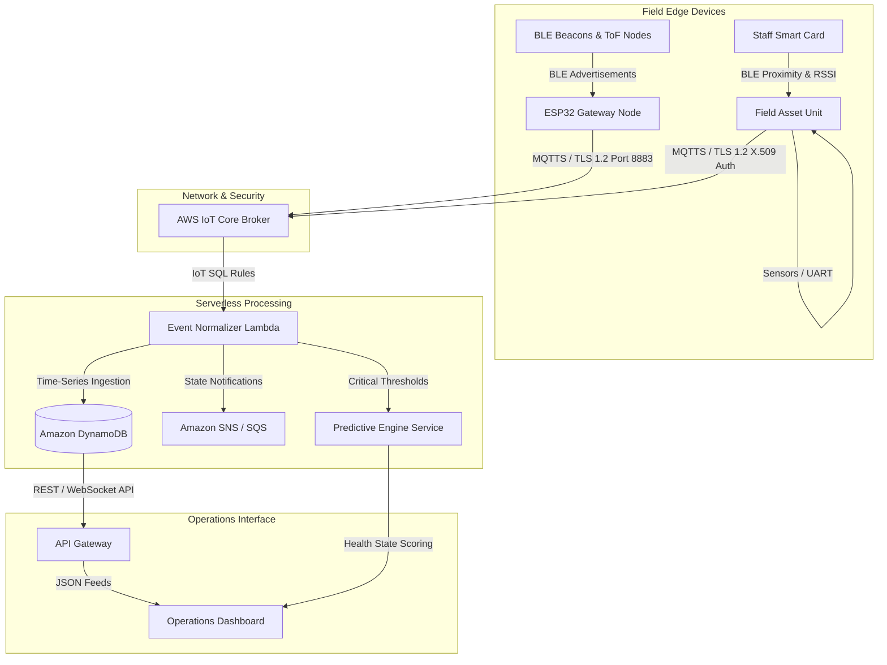

# 🏛️ System Architecture & Data Flow

This document details the multi-tier engineering architecture of the **Edge-to-Cloud IoT Operations Platform**.

---

## 1. End-to-End Topology

---

## 2. Component Breakdown

### A. Edge Layer (C++ / ESP32)
- **Anchor Units:** Fixed field monitoring modules equipped with ambient, vibration, and proximity telemetry. Employs non-blocking state machines and FreeRTOS task scheduling.
- **Smart Cards:** Mobile personnel and asset tracking tags with onboard low-power TFT displays, dual-core task segregation (Display vs BLE/WiFi stack), and deep sleep optimization.
- **BLE Gateways:** High-throughput NimBLE scanners filtering proprietary manufacturer payloads and packaging frames into compact MQTT JSON bursts.

### B. Transport & Authentication
- **Mutual TLS (mTLS):** Hardware-unique X.509 client certificates stored in non-volatile flash.
- **Exponential Backoff Reconnects:** Network failure resiliency ensuring no dropped sensor frames during field connectivity drops.

### C. Serverless Cloud Pipeline (Python / AWS)
- **AWS IoT Rules Engine:** Topic-based query filtration directing raw telemetry directly to execution containers.
- **Normalizer Lambda:** Validates, cleanses, deduplicates, and enriches edge telemetry before persistence.
- **DynamoDB Single-Table Design:** Partitioned by `asset_id` with composite sort keys (`timestamp`) for sub-millisecond retrieval.

### D. Machine Learning Inference Pipeline
- **Predictive Health Model:** Analyzes multi-sensor telemetry (temperature, vibration, load cycles) using a tuned RandomForest classifier to flag degradation patterns before catastrophic failure.
